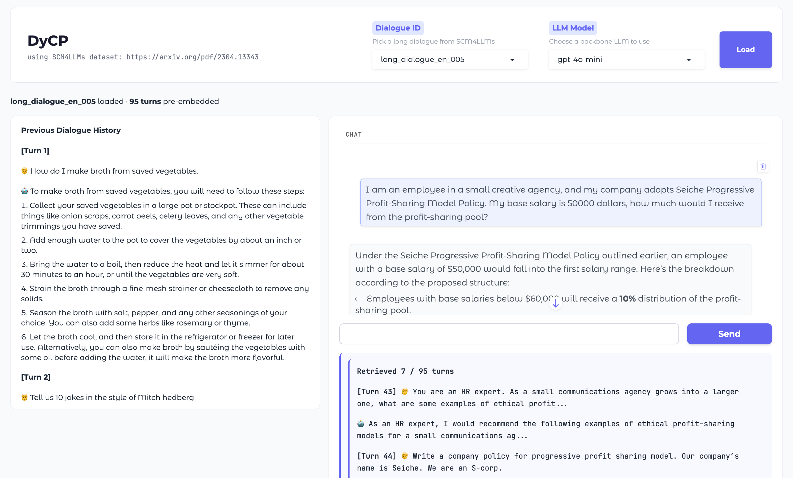

## D-ACR: Dialogue-Aware Context Retrieval for Long-Term Conversational Memory
> Nayoung Choi, Jonathan Zhang, Jinho D. Choi | Emory NLP Lab | Accepted to Findings of EACL 2027
> 
> An earlier version of this work (DyCP) is available [here](https://arxiv.org/abs/2601.07994).
> 

### Overview
D-ACR is a lightweight, training-free method for retrieving context from long conversation histories. Instead of fixing retrieval units (turns, sessions, or summaries) offline, it identifies relevant dialogue segments at query time, conditioned on the current query, with no offline memory construction and no extra LLM calls.

**Key properties:**
- ✅ Query-conditioned segment boundaries (no predefined topic or session boundaries)
- ✅ Preserves sequential dialogue structure
- ✅ Plug-and-play: runs outside the LLM and works with any backbone

### How It Works
D-ACR pre-embeds each user-assistant turn pair as it arrives. When a new user query comes in:
1. The query is embedded and compared against all pre-embedded previous turn pairs.
2. **KadaneDial**, our adaptation of Kadane's maximum-subarray algorithm, finds contiguous high-relevance spans on the z-normalized relevance scores. It is controlled by a gain threshold τ and a stopping threshold θ, and always keeps the top-1 span.
3. Only the selected segments, in chronological order, are fed as context to the LLM.

The paper uses `facebook/contriever-msmarco` as the retriever with τ=0.6 and θ=1.0 for all benchmarks.

## Demo

- The demo uses the [SCM4LLMs dataset](https://github.com/wbbeyourself/scm4llms), which contains 10 long multi-topic dialogues. Select a dialogue and an LLM backend, then click Load. The full dialogue history is displayed and all turns are pre-embedded.
- You can then continue the conversation, with D-ACR running in the background to retrieve only the relevant context at each turn. Sample test queries from SCM4LLMs appear as placeholders to help you get started.

### Installation
```bash
git clone --recurse-submodules https://github.com/emorynlp/DyCP.git
cd DyCP
pip install -r requirements.txt
```

### Quick Start
```bash
# Option 1: Pass keys as arguments
python run_demo.py --openai_api_key {OPENAI_API_KEY} --hf_token {HF_TOKEN}

# Option 2: Set environment variables
export OPENAI_API_KEY={OPENAI_API_KEY}
export HF_TOKEN={HF_TOKEN}
python run_demo.py
```

### Citation
To be updated
